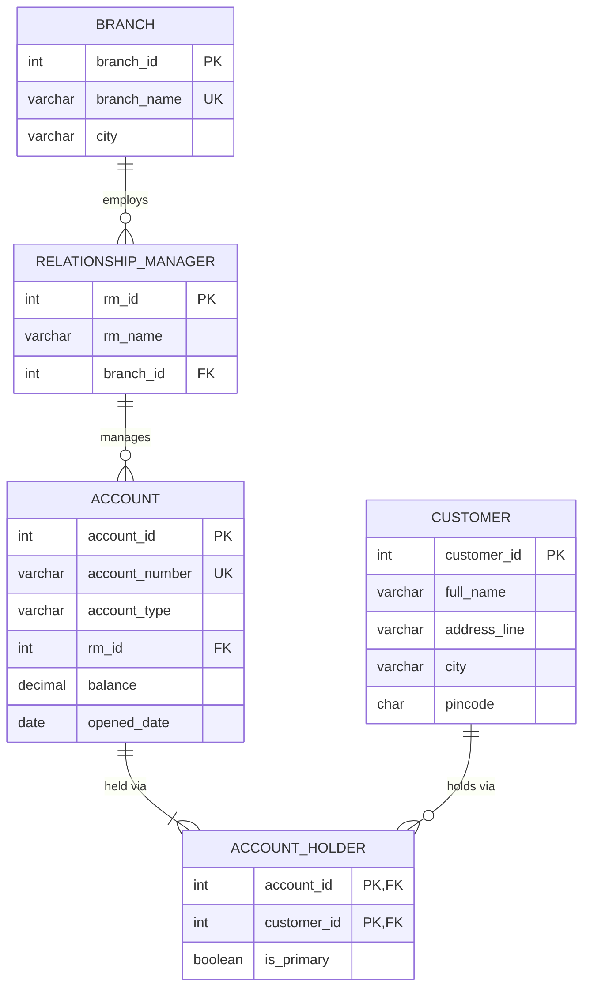

# Bank Branch Accounts: ER Diagram and Notes

## Normalisation (to 3NF/BCNF)
- **0NF sheet:** (customer, address, account_number, account_type, branch, relationship_manager, balance). Customer and branch details repeat on every row, which causes update, insert and delete anomalies.
- **Candidate keys of the sheet:** `account_number`; also (customer, account_type) if one customer has at most one account per type.
- **Functional dependencies:** customer → address; account_number → type, balance, RM; RM → branch.
- **1NF:** address split into line, city and pincode.
- **2NF:** a customer can hold many accounts and an account can have many holders, so the composite key (`account_id`, `customer_id`) lives in `account_holder`, with no partial dependencies.
- **3NF/BCNF:** the transitive dependency account → RM → branch is removed by storing branch only on `relationship_manager`. Every determinant is then a key in its table.

## Data types chosen
| Column | Type | Why |
|---|---|---|
| Surrogate IDs | `INT AUTO_INCREMENT` | Compact and stable; safe as FK targets |
| `balance` | `DECIMAL(15,2)` | Exact arithmetic for money. `FLOAT`/`DOUBLE` introduce rounding errors |
| `account_number` | `VARCHAR(12)` + `UNIQUE` | Identifier, not a number: no arithmetic, leading zeros and prefixes are preserved |
| `account_type` | `VARCHAR(10)` + `CHECK IN (...)` | Small fixed domain enforced at the database level, portable across engines |
| `pincode` | `CHAR(6)` | Fixed length, never used in arithmetic |
| `opened_date` | `DATE` | Enables date-range queries (e.g. last quarter) |
| `kyc_status` | `VARCHAR(10)` | Short status code |
